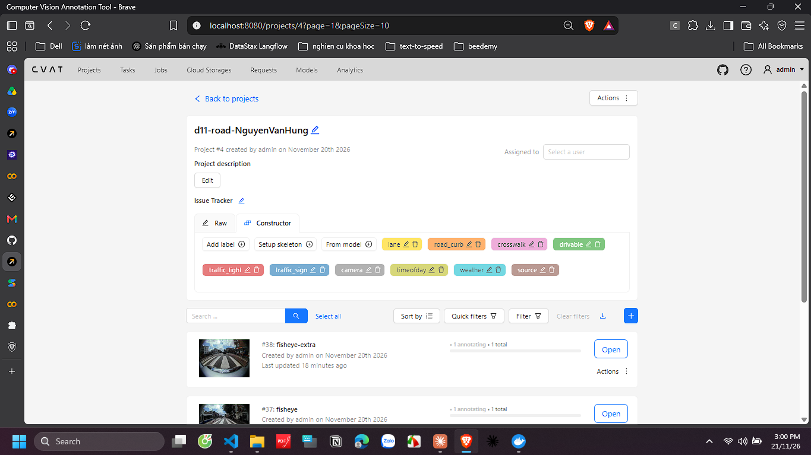
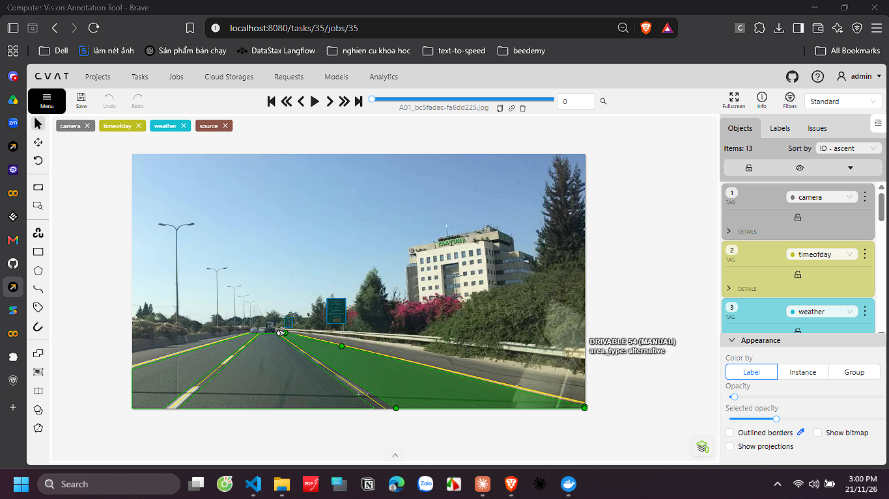
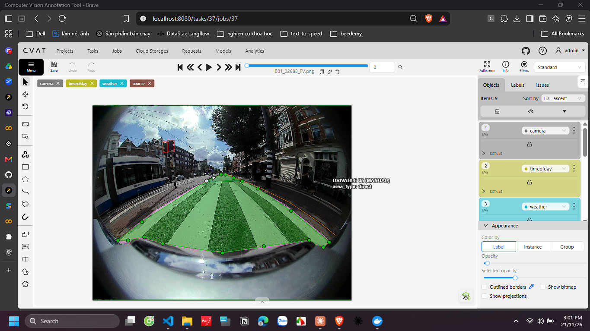
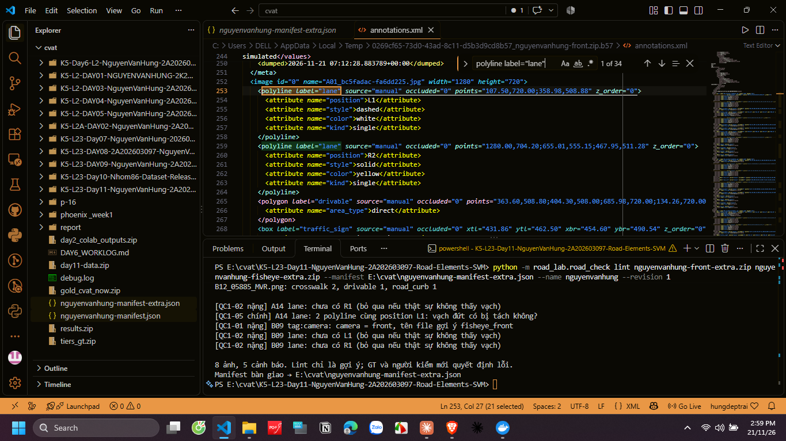

# Báo cáo cá nhân — Ngày 11
Họ tên: Nguyễn Văn Hùng               Mã học viên: 2A202603097
Phiên bản CVAT (Help → About): 2.74.1 (CVAT tự chạy local)
Guideline: Road v1.0    Lần nộp (`revision` trong manifest): 3
Thời điểm export (ngày giờ trên CVAT): 2026-11-21 14:12 giờ VN (XML ghi `dumped` 07:12 UTC; hai file extra export lúc 14:11–14:12; gộp extra vào hai zip chính lúc 15:26 giờ VN)    Số lần nộp lại sau Rework: 2

## 1. Kiểm project
| Mục | Đúng như guideline Road v1.0? | Ghi chú |
| --- | --- | --- |
| 6 label, đúng kiểu | Đúng | lane, road_curb (polyline); crosswalk, drivable (polygon); traffic_light, traffic_sign (rectangle). Dán JSON từ `python -m road_lab.taxonomy` vào tab Raw |
| Thuộc tính và giá trị | Đúng | lane: position/style/color/kind; drivable: area_type; traffic_light: color/type/facing/edge_zone; traffic_sign: group/facing/edge_zone |
| 4 tag ảnh | Đúng | camera, timeofday, weather, source; mỗi tag là label kiểu Tag có một thuộc tính select `value` |
Cách kết thúc polyline trên bản CVAT này: bấm phím N sau khi click điểm cuối
Cách đặt tag ảnh trên bản CVAT này: công cụ Tag ở thanh bên trái, chọn label, Submit; rồi mở Details ở bảng Objects bên phải để sửa `value` (CVAT tự điền giá trị đầu danh sách)

## 2. Số lượng đã gán
(Số liệu khớp manifest revision 3, lấy từ `road_check lint`; tổng front 16 ảnh và fisheye 12 ảnh gồm cả extra. Số lane của task front là 32 (revision 1 là 34) vì gộp 3 vạch đôi và thêm R1 ở A06.)
| Task | Ảnh | lane | road_curb | crosswalk | drivable | traffic_light | traffic_sign |
| --- | ---: | ---: | ---: | ---: | ---: | ---: | ---: |
| front | 12 | 32 | 5 | 6 | 27 | 34 | 32 |
| front-extra (đã làm 4 / 4) | 4 | 12 | 1 | 5 | 8 | 11 | 17 |
| fisheye | 8 | 8 | 5 | 11 | 10 | 10 | 13 |
| fisheye-extra (đã làm 4 / 4) | 4 | 0 | 5 | 5 | 4 | 0 | 0 |

## 3. Bảng ca khó
| Ảnh | Nhãn | Phân vân giữa | Đã chọn | Lý do |
| --- | --- | --- | --- | --- |
| B01 | drivable | Vùng lái có phủ lên vạch ngựa vạn hay khoét ra | phủ | Vạch ngựa vạn nằm trên mặt đường xe đi được nếu đường trống; guideline gán theo "đi được nếu đường trống" và không khoét lỗ. crosswalk là polygon riêng nên chồng lên được. Trong file export, polygon drivable của B01 nằm gần như trọn trong polygon crosswalk (không có lỗ khoét) |
| B01 | lane | Vạch trắng chéo ở mép trái, phải là L1/R1 hay vạch biên làn xe đạp, làn tàu điện | không vẽ lane | Ảnh không có vạch kẻ làn dọc ở giữa; không chắc vạch ở mép thuộc làn xe mình. File export của B01 không có polyline lane nào |
| B01 | tag weather | clear hay overcast | clear | Trời có mây lớn nhưng nắng và mặt đường khô |
| A01 | road_curb | Có cần vẽ road_curb không | Không vẽ | Mép đường bên phải đã có vạch vàng, bên trái có vạch trắng mép ngoài (QCVN 3.1) nên là lane, không phải road_curb; rào kim loại không phải vỉa |

## 4. Phiếu QC 1 nhận được
Người kiểm lô của em: hthuong (Hoàng Thu Hương)   Quyết định nhận được: **Rework** (8 lỗi nặng; 17 lỗi chính / 275 nhãn ≈ 6,2 % > 5 %)
Phiếu kiểm 20 ảnh (12 front + 8 fisheye), revision 1. Em đã đối chiếu từng mã lỗi với `annotations.xml` và `road_check lint` của em; số lỗi khớp hoàn toàn.
| Mã lỗi | Số lỗi | Đồng ý? | Đã sửa? |
| --- | ---: | --- | --- |
| QC1-02 thiếu L1/R1 (nặng) | 4 | Đồng ý. A05 thiếu cả L1 và R1, A06 và A09 thiếu R1. A05 em không vẽ thêm vạch, chờ coach xác nhận miễn vì ảnh không thấy vạch sơn | Đã sửa ở revision 2: thêm R1 cho A06. A09 và A05 ảnh không thấy vạch sơn nên không vẽ thêm, chờ coach xác nhận miễn |
| QC1-03 position (nặng) | 4 | Đồng ý. B05 đến B08 đều để `L1` mặc định, đúng ra phải là `other` (xác nhận trong XML) | Đã sửa: đổi `position = other` cho cả 4 ảnh |
| QC1-04 chiều polyline (chính) | 5 | Đồng ý. A01 (L2), A06 (L1), A07 (L1), A12 (L1 và L2) vẽ từ xa về gần | Đã sửa: vẽ lại 5 polyline từ gần ra xa |
| QC1-05 vạch đôi, vạch đứt bị tách (chính) | 4 | Đồng ý. A04, A09, A11 là vạch đôi bị tách thành hai polyline `kind = double` cùng position; B04 có hai polyline cùng L1 (một solid, một dashed) | Đã sửa: gộp A04, A09, A11 thành một polyline `kind = double`; B04 đổi vạch solid ngoài cùng thành L2 |
| QC1-11 fisheye (chính) | 8 | Đồng ý. 7 box chưa bật `edge_zone` (B02 hai đèn, B03 một biển, B05 bốn biển) và lane B08 chỉ có 3 điểm | Đã sửa: bật `edge_zone` cho 7 box và thêm điểm cho lane B08 |
| Các mã còn lại (QC1-01, 06 đến 10, 12) | 0 | Đồng ý | Không cần sửa |
Ca mơ hồ hthuong gửi coach (A05 miễn QC1-02; A04, A09, A11 là vạch đôi hay hai vạch riêng): em coi A04, A09, A11 là vạch đôi vì cùng `kind = double`, cùng màu, chạy song song sát nhau. Kết luận Rework không phụ thuộc các ca này.
Kết quả nộp lại (revision 2): `road_check lint` chỉ còn 3 cảnh báo QC1-02 ở A05 (thiếu L1, R1) và A09 (thiếu R1), là ảnh không thấy vạch sơn, chờ coach xác nhận miễn; ngoài ra còn 2 cảnh báo nhẹ (box < 8 px). Không còn lỗi chính.
Revision 3: gộp front-extra (A13–A16) và fisheye-extra (B09–B12) vào hai zip chính theo SUBMISSION.md, front từ 12 lên 16 ảnh, fisheye từ 8 lên 12 ảnh; không đổi nhãn nào đã nộp ở revision 2. `road_check lint` vẫn 3 nặng (QC1-02 ở A05 và A09, em xác nhận là báo sai vì ảnh không thấy vạch sơn nên không vẽ thêm vạch), 0 chính, 2 nhẹ, như revision 2. Hai zip và manifest của revision 2 (trước khi gộp extra) được giữ trong thư mục `r1/`.

## 5. Kiểm file export
| File | Mở lại được? | Số shape ảnh 1 (job / file) | Số shape ảnh 2 (job / file) | Tag camera có trong XML? |
| --- | --- | --- | --- | --- |
| nguyenvanhung-front.zip | Có (lint đọc được 16 ảnh) | A01: 9 / 9 | A02: 8 / 8 | Có, camera = front ở 16/16 ảnh |
| nguyenvanhung-fisheye.zip | Có (lint đọc được 12 ảnh) | B01: 5 / 5 | B02: 8 / 8 | Có, đúng hậu tố FV/RV/MVL/MVR ở 12/12 ảnh |
(Mở lại bằng `python -m road_lab.road_check lint`. Số shape "file" lấy từ dòng `A01_...: ...` của lint; số shape "job" đếm ở bảng Objects trong CVAT.)

## 6. Ảnh chụp màn hình
1. Tab Labels của project: 
2. Một ảnh camera trước đã gán đủ (làn, vùng lái, đèn/biển): 
3. Một ảnh fisheye đã gán, phóng to đoạn polyline cong: 
4. Một đoạn XML có `<polyline label="lane">`: 

## 7. Tự đánh giá
Lỗi em mắc nhiều nhất hôm nay (theo mã QC1-xx), và cách tránh ở Ngày 20:
Lint lần đầu trên 20 ảnh bắt buộc báo 8 lỗi nặng, 17 lỗi chính, 2 lỗi nhẹ. Hai mã nặng, mỗi mã 4 lần, là QC1-02 và QC1-03.
QC1-02 (thiếu L1/R1): A05 thiếu cả L1 lẫn R1, A06 và A09 thiếu R1. Em vẽ vạch theo thói quen và bỏ qua vạch ở góc ảnh hoặc ở xa.
Ngày 20 em sẽ quét ảnh theo thứ tự bên trái, bên phải làn đang đi trước khi sang bước khác, và chỉ bỏ vạch khi chắc là không có.
QC1-03 (position): ở camera hai bên (B05 đến B08) em để position mặc định L1 thay vì `other`, vì CVAT tự điền giá trị đầu danh sách và em không mở Details để sửa.
Cách tránh: sau khi vẽ xong mỗi vạch, mở Details kiểm cả bốn thuộc tính ngay; không dựa vào giá trị mặc định.
Lỗi chính: QC1-04 (5 polyline có điểm đầu cao hơn điểm cuối, tức vẽ từ xa về gần: A01, A06, A07, A12 hai vạch), QC1-05 (4 chỗ vạch đứt bị tách thành nhiều polyline: A04, A09, A11, B04)
và QC1-11 (8 gợi ý về edge_zone và số điểm trên fisheye: B02, B03, B05, B08). Cách sửa: vẽ từ gần ra xa, nối lại vạch đứt thành một polyline, và rà edge_zone theo bán kính 80 % ở các ảnh fisheye.

Nhãn của em đi vào model ở đâu? Chọn một lỗi đã sửa và nói nó làm model học sai thế nào:
Polyline làn là đích học của model phát hiện làn kiểu row-anchor: với mỗi hàng ảnh, model học x của vạch. Nếu một polyline bị vẽ ngược chiều
hoặc dừng sớm 40 px thì các hàng ở phần xa bị ghi là "không có làn", model học rằng vạch biến mất sớm và nhìn kém xa hơn thực tế.
Nếu position của camera bên bị để L1 thay vì other, model học một vị trí làn không tồn tại ở góc nhìn đó, làm sai thông tin về làn xe đang đi.
Thiếu L1 hoặc R1 làm model coi làn đang đi là rộng hơn thực tế.

## 8. (Tùy chọn, buffer) Từ polyline đến đích row-anchor
Bỏ qua (không chấm điểm).
